<div align="center">


# Safar · सफ़र

**A compiler that type-checks your Delhi Metro journey.**

Write a trip in a tiny language. Safar lexes, parses and semantically checks it against the real
metro network, then compiles it into a journey card with stations, interchanges and an estimated time.
Mistakes get rustc-style errors with one-click fixes.

[](https://github.com/nox-pie/safar/actions/workflows/ci.yml)
[](https://safar-compiler.vercel.app)


[](LICENSE)

**[▶ Try the live playground](https://safar-compiler.vercel.app)** · [Language reference](docs/LANGUAGE.md) · [Architecture](docs/ARCHITECTURE.md)

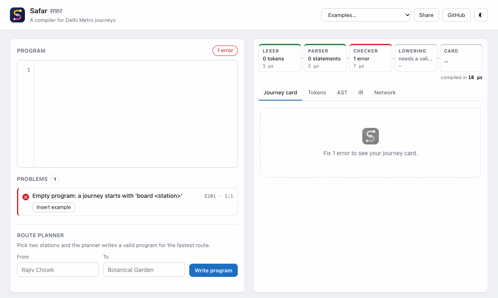

</div>

---

## The problem

> **Compiler: Delhi Metro Journey**
>
> A program looks like: `board Rajiv Chowk; ride Yellow to Hauz Khas; change Magenta; ride to Botanical Garden; exit`
>
> **Output:** a journey card with stations, interchanges and an estimated time.
>
> **Semantic check ("is this allowed?"):** a station must be on the line you are riding, and you can
> only change lines at a real interchange like Kashmere Gate or Mandi House.

It looks like a toy, but it contains every hard part of a real compiler: multi-word identifiers
(`Botanical Garden`), a symbol table that is a **graph** (232 stations, 9 lines, branch lines), semantic
rules that depend on **state** (where you are, which line you're on), and the expectation that errors
are *helpful*, not just correct.

## What Safar does

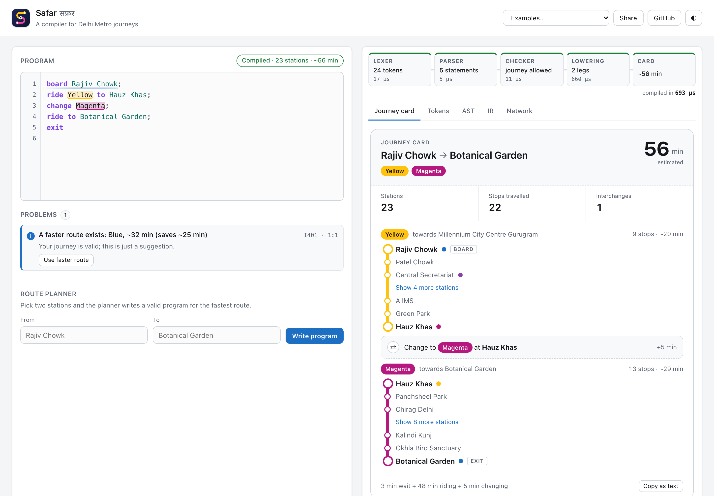

- **Compiles journeys to a card**: every station on every leg, the direction of travel ("towards
  Millennium City Centre Gurugram"), interchanges, and a time estimate with its breakdown.
- **Enforces the rules**: stations must be on the line you ride, and changes only happen at real
  interchanges served by the new line. Interchanges are *derived* from the network, never hard-coded.
- **Explains mistakes**: 27 diagnostic codes with precise spans, "did you mean" suggestions, and
  **fix-its** that rewrite your program. Some are whole routes computed by the planner.
- **Plans routes**: a Dijkstra planner over (service, station) states writes a valid program for the
  fastest trip, and warns when your valid journey could be at least 5 minutes faster.
- **Shows its work**: a live pipeline strip (Lexer → Parser → Checker → Lowering) with per-phase
  timings, plus Tokens, AST and IR views.
- **Runs anywhere**: the same compiler powers the browser playground, a `safarc` CLI and a JSON API.

## Errors that help

| Not an interchange: suggests where to change | Typos: every one caught, none cascade |
| --- | --- |
| 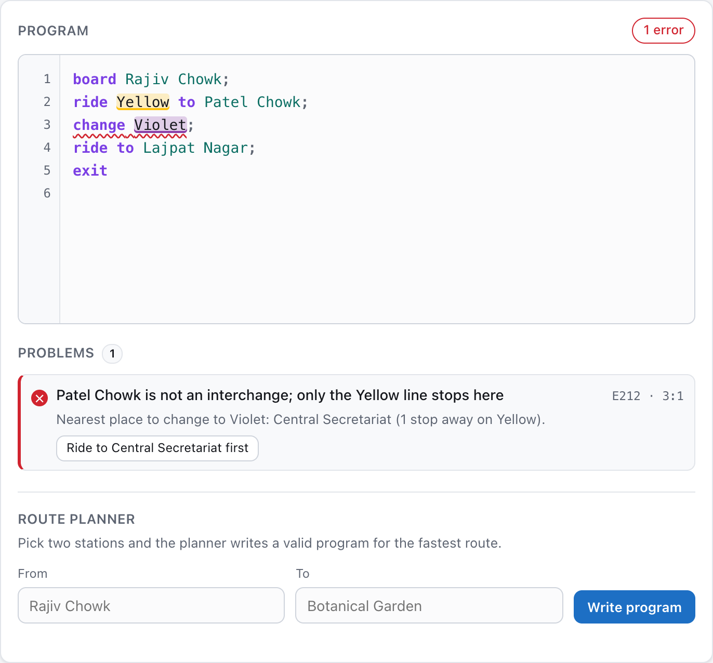 | 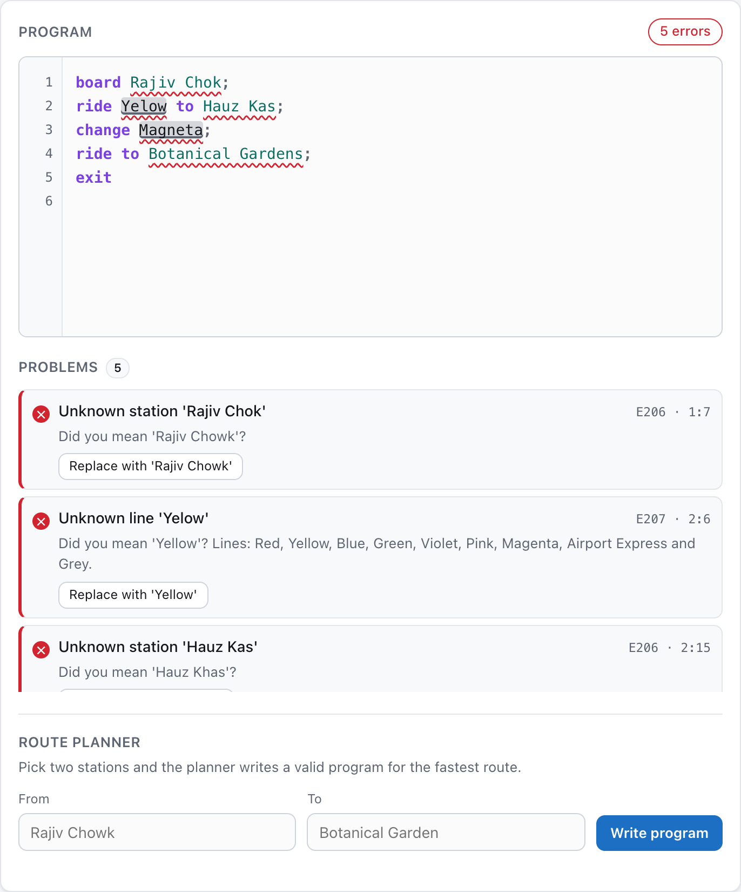 |

The checker keeps going after an error. It either *repairs* its state (assumes the change you asked
for) or *poisons* it (position unknown after a misspelled station), so one mistake is reported once.
Every fix-it is property-tested to actually remove the error it targets.

## The `safarc` CLI

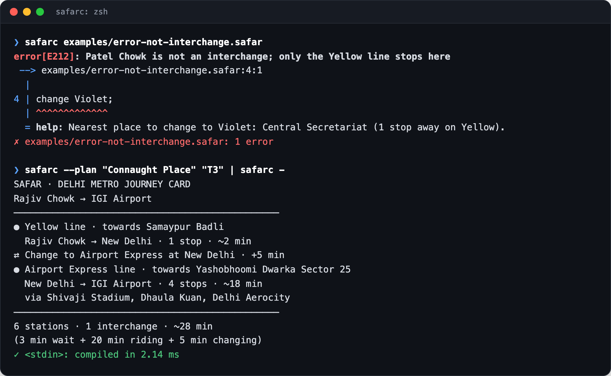

```bash
safarc journey.safar                       # journey card, exit 0 · errors, exit 1
safarc --emit json journey.safar           # also: card | ir | ast | tokens
safarc --plan "Kashmere Gate" "Noida Sector 18"
echo "board CP; ride Yellow to INA; exit" | safarc -
```

The CLI runs **straight from TypeScript source** on Node ≥ 22.18 (native type stripping), with no build
step. The codebase sticks to erasable TypeScript syntax so one source tree is the library, the CLI and
the browser bundle.

## How it works

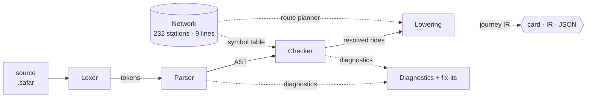

| Phase | What happens | Key idea |
| --- | --- | --- |
| **Lexer** | Text → keywords, words, separators, comments | No identifier rule: names are *runs of words*, so `R.K. Puram` and `Sant Surdas (Sihi)` just work |
| **Parser** | Hand-written recursive descent → AST with spans | Recovers by synchronizing at `;`/newline, and infers missing separators (`board X ride …`) |
| **Checker** | Abstract interpretation over *(station, line)* state | The network is the symbol table; branch lines are *services*, so "is there a direct train?" is a membership test |
| **Lowering** | Rides → legs, transfers, time | Detects same-train continuations vs. same-line train changes |
| **Planner** | Dijkstra over *(service, station)* nodes | Shares the checker's cost model, which a property test verifies |

<table>
<tr><td width="33%">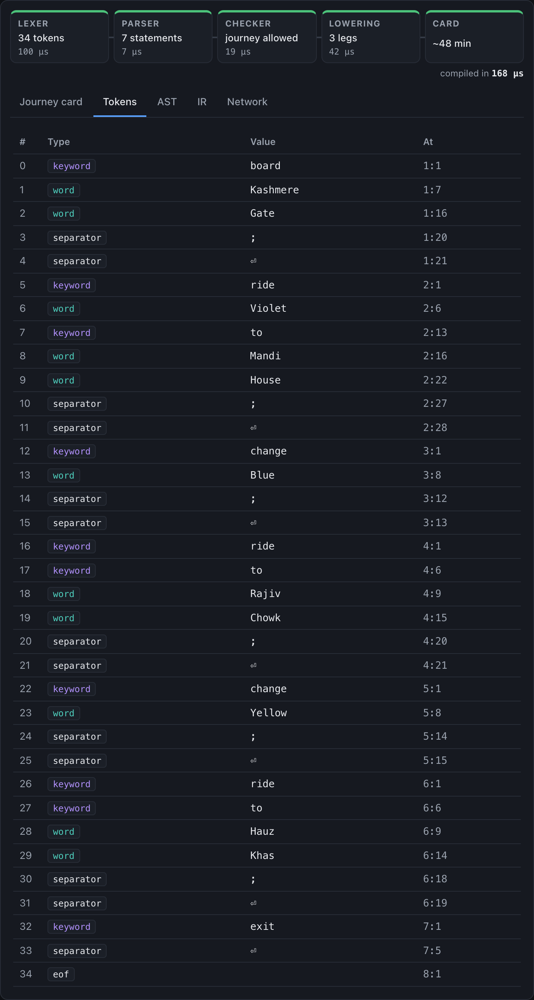</td><td width="33%">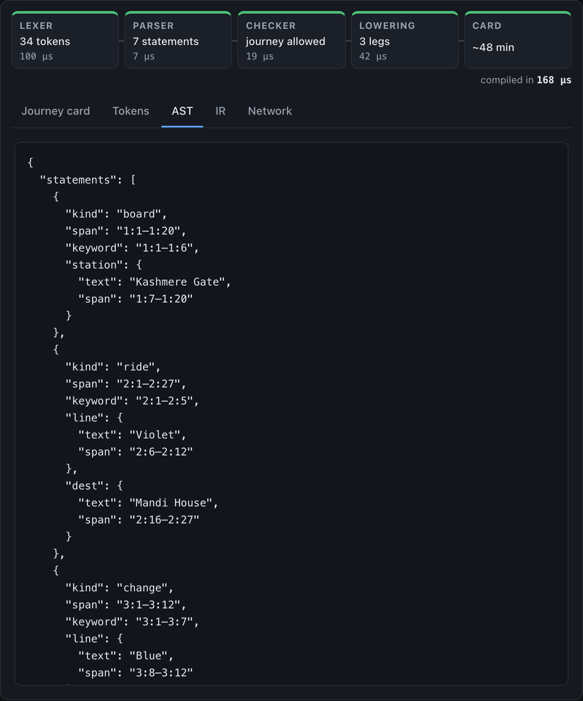</td><td width="33%">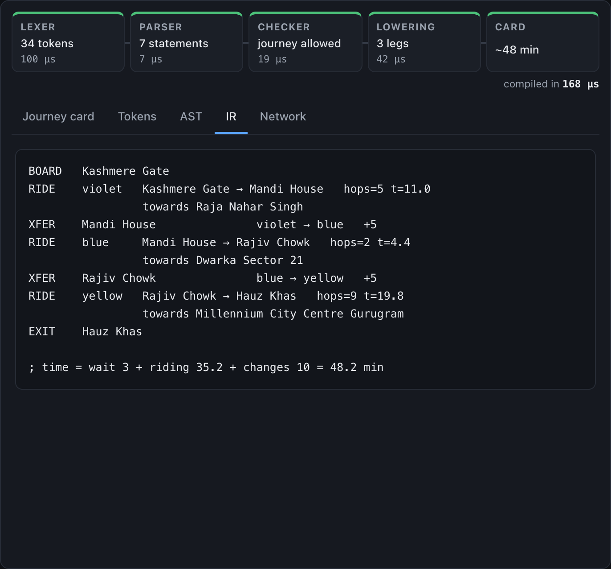</td></tr>
<tr><td align="center">Tokens</td><td align="center">AST</td><td align="center">IR</td></tr>
</table>

The full write-up, including design decisions, error recovery and the overlay-editor technique, is in
**[docs/ARCHITECTURE.md](docs/ARCHITECTURE.md)**.

## Engineering highlights

- **Grammar-aware fuzzing found real bugs.** A naive token-soup fuzzer never got past the parser. A
  generator that simulates a traveller (mostly legal moves, some illegal, plus text mutations) reaches
  **all 27 diagnostics** and exposed two error-recovery bugs, now fixed with regression tests.
- **Invariants, not just examples.** Property tests check that the compiler never throws on 6,000
  generated programs, that every fix-it resolves its error, and that planner and checker agree on 1,500
  random routes.
- **Measured, then optimized.** Benchmarking showed the faster-route analysis dominating every compile.
  A binary heap, dense integer node IDs with typed arrays, and a bounded Levenshtein made the hot path
  **about 15× faster** (480 µs → 31 µs), fast enough to recompile and re-plan on every keystroke.
- **Zero runtime dependencies.** The compiler, CLI and playground are plain TypeScript and the DOM. The
  whole playground is about 16 kB gzipped.

## Tech stack

| | |
| --- | --- |
| **Language** | TypeScript 7 in strict mode, with `erasableSyntaxOnly`, `verbatimModuleSyntax` and explicit `.ts` imports |
| **Compiler** | Hand-written lexer and recursive-descent parser, checker, lowering pass, Dijkstra planner, binary heap; no libraries |
| **Web** | Vite 8, vanilla DOM, CSS custom properties (light/dark), textarea-over-`<pre>` highlighting overlay |
| **CLI** | Node ≥ 22.18 native TypeScript execution, `node:util` `parseArgs`, ANSI diagnostics |
| **Testing** | Vitest 5: unit, golden snapshots, property-based fuzzing, CLI (subprocess and in-process), v8 coverage with enforced thresholds |
| **CI/CD** | GitHub Actions (typecheck → test + coverage → build → CLI smoke test → benchmark); Vercel deploys `main` to production and every pull request to a preview |

## Quality

| Metric | Value |
| --- | --- |
| Tests | 62, running in ~3 s |
| Line coverage (compiler + CLI) | 98.5%, with thresholds enforced in CI |
| Fuzzed programs per run | 6,000 (seeded, reproducible) |
| Diagnostics reached by fuzzing | 27 / 27 |
| Compile time, typical program | ~30 µs (`npm run bench`) |

## Getting started

```bash
git clone https://github.com/nox-pie/safar.git && cd safar
npm install

npm run dev            # playground at http://localhost:5173
npm test               # full test suite
npm run test:coverage  # with coverage report
npm run bench          # compile-time benchmark
npm run safarc -- examples/problem-statement.safar
```

## The language in 30 seconds

```text
board Kashmere Gate        # start: exactly once, first
ride Violet to Mandi House # ride a line to a station on it
change Blue                # only at an interchange the new line serves
ride to Rajiv Chowk        # keep riding the current line
exit                       # end: exactly once, last
```

Names are case, space and punctuation insensitive, and common aliases work (`Connaught Place`, `INA`,
`T3`). The full grammar, time model and diagnostic catalogue are in **[docs/LANGUAGE.md](docs/LANGUAGE.md)**.

## Project structure

```text
src/
  compiler/          the compiler: pure TypeScript, no DOM, no dependencies
    lexer.ts           tokens
    parser.ts          recursive descent → AST, with error recovery
    checker.ts         semantic analysis, diagnostics, fix-its
    lower.ts           rides → journey (legs, transfers, time)
    network.ts         symbol table, name resolution, Dijkstra planner
    network-data.ts    232 stations across 9 lines
    min-heap.ts        planner priority queue
    diagnostics.ts     spans, fix-its, rustc-style rendering
  cli/safarc.ts      command-line compiler
  ui/                playground: editor overlay, completions, pipeline, card
examples/            .safar programs, shared by the UI, CLI and golden tests
tests/               unit, golden, property-based, network integrity, CLI
docs/                language reference, architecture, images
```

<details>
<summary><b>More screenshots</b></summary>

| Dark mode | Mobile |
| --- | --- |
| 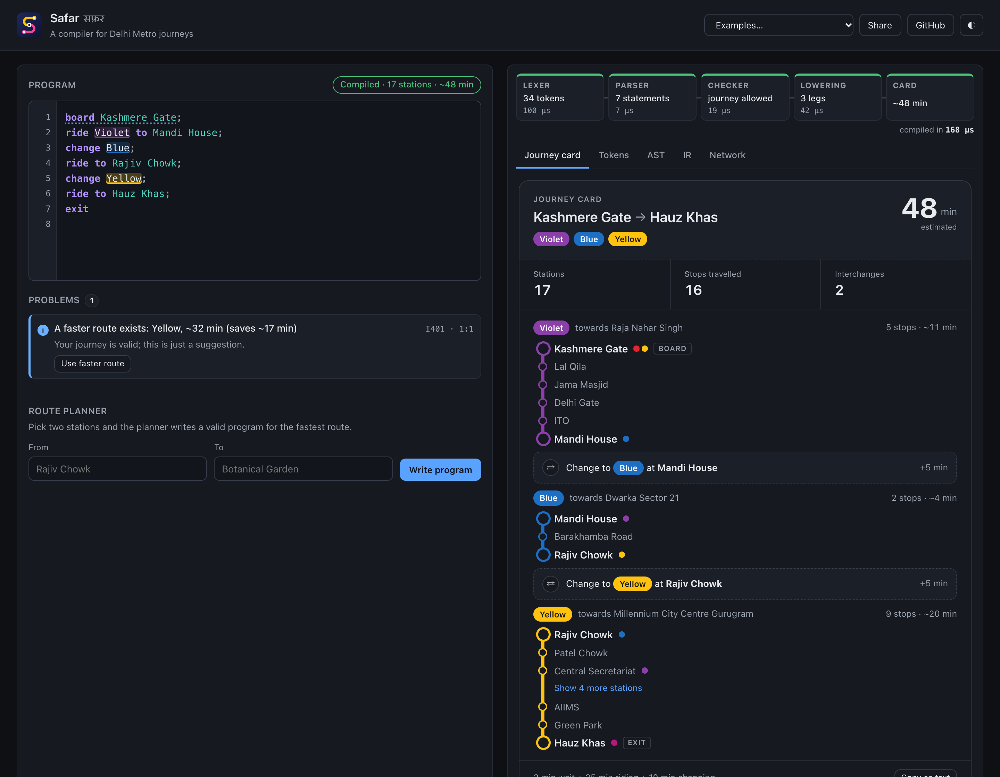 | 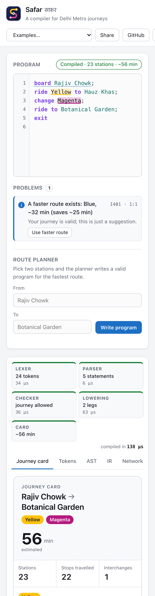 |

</details>

## Limitations and next steps

- Network data is a hand-entered snapshot (Red, Yellow, Blue, Green, Violet, Pink, Magenta, Airport
  Express and Grey lines). Aqua, Rapid Metro and Phase 4 sections under construction are not included.
- Times come from per-stop averages, not timetables. The goal is a consistent cost model shared by the
  checker and the planner.
- Possible extensions: fares by distance slab, walking links between nearby stations (e.g. Noida Sector
  51 ↔ 52) as an opt-in transfer, and a Language Server so any editor gets the same diagnostics.

## License

[MIT](LICENSE) © Prashant Kumar. Station data is compiled from public Delhi Metro maps. This
project is not affiliated with DMRC.
