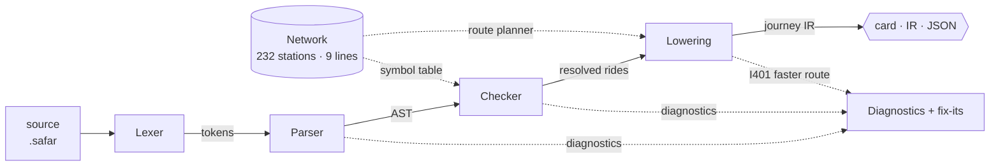

# Architecture

Safar is a classic multi-pass compiler, kept small enough to read in an evening. The compiler is a
pure TypeScript library with **no runtime dependencies and no DOM access**. The web playground, the
CLI and the test suite are three thin front-ends over the same `compile()` call.



| Phase | File | Input → output |
| --- | --- | --- |
| Lexer | [lexer.ts](../src/compiler/lexer.ts) | text → tokens (keywords, words, separators, comments) |
| Parser | [parser.ts](../src/compiler/parser.ts) | tokens → AST + syntax diagnostics |
| Checker | [checker.ts](../src/compiler/checker.ts) | AST + network → resolved rides + semantic diagnostics |
| Lowering | [lower.ts](../src/compiler/lower.ts) | rides → journey (legs, transfers, time) |
| Planner | [network.ts](../src/compiler/network.ts) | (from, to) → fastest route |
| Back-ends | [render-text.ts](../src/compiler/render-text.ts), [serialize.ts](../src/compiler/serialize.ts), [src/ui](../src/ui) | journey → card / IR / JSON / HTML |

## 1. Lexer: words, not identifiers

Station names are multi-word and full of punctuation (`R.K. Puram`, `Sant Surdas (Sihi)`), so the
lexer has no identifier rule. Anything that isn't whitespace, `;` or `#` is a **word**, and the
parser joins runs of words into names. Newlines are separators, so programs can be written one
statement per line without semicolons. Comments are kept as tokens rather than discarded, because
the editor's syntax highlighter is driven by the same token stream.

## 2. Parser: recursive descent with recovery

The grammar is six productions, so a hand-written recursive-descent parser beats a generator: it is
shorter, has no build step, and gives full control over error messages. Two recovery strategies keep
it useful while you are typing:

- **Synchronize at separators.** An unknown command or stray token skips to the next `;` or newline
  and parsing continues.
- **Infer missing separators.** If a statement is followed by a keyword (`board X ride …`), the
  parser reports *E102: Missing ';'* with an insert-`;` fix-it, then **resumes at that keyword**
  instead of throwing the rest of the line away.

Every AST node carries source spans for its keyword and names, which is what makes precise
underlines and fix-its possible.

## 3. Checker: abstract interpretation over the journey

Semantic analysis walks the AST like an interpreter whose state is *(station, line)*:

```text
board S          → station = S
ride L to D      → require L stops at station and D, and one train runs between them; station = D, line = L
change L         → require station is an interchange that L serves; line = L
```

Design decisions worth calling out:

- **The network is the symbol table.** Stations and lines are the declarations; "is this station
  on this line?" is the type check. Interchanges are **derived** (any station on two or more lines),
  never listed by hand, so adding a line keeps them correct automatically.
- **Branches are services, not special cases.** Each line is a list of *services*: ordered station
  runs that a single train covers. Blue has Dwarka ⇄ Noida and Dwarka ⇄ Vaishali sharing track up to
  Yamuna Bank. "Is there a direct train?" becomes "do both stations appear in one service?", and
  E216 falls out naturally.
- **Recovery without cascades.** After an error the checker either *repairs* the state (assumes
  the change you asked for happened) or *poisons* it (position unknown after a misspelled station).
  Checks that need the poisoned value are skipped, so one typo produces one error. The fuzzer found
  two bugs here; see [Testing](#7-testing-strategy).
- **Fix-its are plain text edits** (`{ span, text }`), produced by the same code that detects
  the error. Some come from a nearest-interchange search, and some from the route planner (E208's fix
  is a complete working route from where you are).

## 4. Lowering: from rides to a journey

Lowering turns resolved rides into legs (with direction: "towards *terminus*") and transfers. Two
consecutive rides on the same line are a **continuation** if some shared service runs both in the
same direction; otherwise they are a same-line **train change** (other branch, or doubling back),
which costs 4 minutes. Changing lines costs 5. The time model is a small set of constants that the
planner shares.

## 5. Route planner: Dijkstra over (service, station)

The planner powers the playground's route planner, the "faster route exists" hint (I401), and E208's
fix-it. It runs Dijkstra on a state graph whose nodes are *(service, station)* pairs:

- ride to a neighbouring station on the same service: the line's per-stop time
- switch service at the same station: interchange (5) or same-line train change (4)

Using the **same cost model as the checker** is a deliberate invariant: a planned route, compiled back
into a program, must compile cleanly and report exactly the planned time. A property test checks
this over 1,500 random station pairs.

### Performance work

The benchmark ([scripts/bench.ts](../scripts/bench.ts)) showed every valid compile paying for the
I401 analysis. The planner was optimized in two steps:

| Version | Valid program | Typo-heavy program |
| --- | --- | --- |
| Linear-scan Dijkstra on string-keyed `Map`s; plain Levenshtein | ~480 µs | ~2,100 µs |
| Binary-heap priority queue | ~140 µs | ~630 µs |
| Dense integer node IDs, `Float64Array`/`Int32Array` state, bounded Levenshtein with reused rows | **~31 µs** | **~240 µs** |

That's about **15× on the hot path**, fast enough to recompile and re-plan on every keystroke.

## 6. Diagnostics: one model, three renderers

A diagnostic is `{ severity, code, message, span, help?, fix? }`. The same object renders as:

- **web**: wavy underlines in the editor, a clickable problems list, one-click fix buttons
- **CLI**: rustc-style output with source excerpt, caret underline and ANSI colour
- **JSON**: `safarc --emit json`, for tooling

## 7. Testing strategy

| Layer | What it proves |
| --- | --- |
| Unit tests | Each rule and each diagnostic, with exact codes |
| Golden tests | Full output (diagnostics, card, IR, JSON) of every example is snapshotted; any change is a reviewable diff |
| **Grammar-aware fuzzing** | 6,000 generated programs: a "traveller" generator that makes mostly legal moves plus random mutations, alongside token soup. The compiler never throws, spans stay in bounds, and a journey is produced exactly when there are no errors. |
| **Diagnostic reachability** | A meta-test parses every code the compiler declares and asserts the fuzzer reaches all of them, so a new diagnostic can't ship untested |
| **Fix-its resolve their error** | For every fix-it the fuzzer triggers (thousands), applying it removes the targeted diagnostic |
| **Planner ⇄ checker agreement** | Planned routes compile cleanly with identical time, and durations are symmetric |
| Network integrity | Branches connect, one connected network, aliases resolve, interchange set is pinned |
| CLI | Exit codes, stdin, JSON, `--plan`, run both as a subprocess and in-process (for coverage) |

**Bugs found by fuzzing.** A first, naive token-soup fuzzer never got past the parser: it reached
none of the semantic checks. Switching to the grammar-aware generator exposed two real recovery bugs:

1. After *"X is not on the Blue line"*, the next ride reported a bogus second error ("Blue doesn't stop
   at X"). The checker now marks the position unknown instead.
2. A typo in a ride's destination hid a genuine error about the boarding line. That check now runs
   first.

Both have regression tests.

## 8. Web playground

Vanilla TypeScript and DOM, with no framework: the UI is one editor, a problems list and a few
rendered views, and the interesting work is in the compiler.

- **Syntax highlighting overlay.** A transparent `<textarea>` sits over a `<pre>` that renders the
  highlighted source, so native editing (undo, IME, selection, accessibility) is kept. Highlighting
  paints each character with a token class, line colour and diagnostic severity, then merges runs of
  identical characters into spans, which makes overlapping ranges trivial.
- **Context-aware completion** uses checker state: after `ride to`, stations on the line you're
  currently on rank first.
- **Live pipeline profiler.** Browsers coarsen `performance.now()`, so each phase is warmed up and then
  run in a loop for about 1 ms. Profiling is deferred until typing pauses, so it never costs keystrokes.
- Fix-its are applied with `execCommand('insertText')` so they land on the browser's undo stack.

## 9. Zero-build CLI

`safarc` runs straight from TypeScript source using Node ≥ 22.18's native type stripping. To make that
possible the codebase uses only erasable TypeScript syntax (`erasableSyntaxOnly`,
`verbatimModuleSyntax`) and explicit `.ts` import paths, which Vite also understands. The same source
tree is the library, the CLI and the browser bundle.

## Non-goals and trade-offs

- **Data is a hand-entered snapshot**, not a live feed: there is no network access and the output is
  deterministic. Integrity tests stand in for a schema.
- **The time model is deliberately simple** (per-stop averages): the point is a consistent cost
  model shared by the checker and the planner, not timetable accuracy.
- **No LSP or Monaco.** A textarea overlay covers what this language needs and keeps the whole
  playground bundle around 16 kB gzipped.
